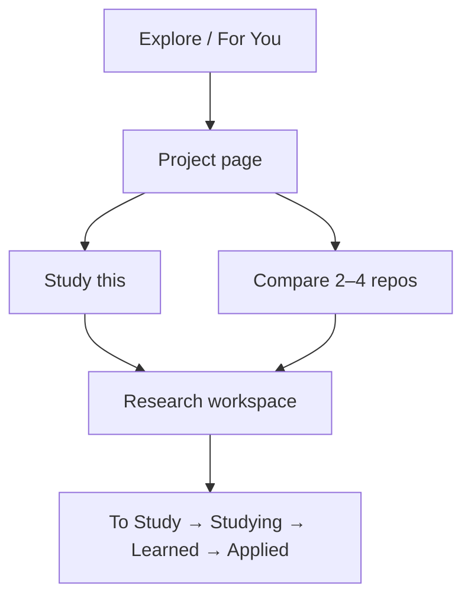

<div align="center">

# BharatCode Atlas

**What should I investigate next, and what can I learn from how other teams built it?**

A project-discovery and research workspace for the BharatCode Build League.
Explore 294 projects, compare how they were built, and keep your own research notes.

[](https://github.com/aayush-as69/BharatCode-Atlas/actions/workflows/atlas-ci.yml)


[Quick start](#quick-start) · [Features](#features) · [How it works](#how-it-works) · [Configuration](#configuration) · [Security](#security-and-privacy) · [Landing page](landing/index.html)

</div>

---

## Features

| | |
|---|---|
| **Explore** | Search, filter by signal, sort, and page through the full corpus (294 projects at the last sync). Categories, rankings and hidden-gem discovery. |
| **For You** | Recommendations from your interests and, optionally, public GitHub profiles. No sign-in. |
| **Repository intelligence** | Technology and architecture signals read from dependency manifests, file paths and READMEs, with the evidence shown next to each claim. |
| **Compare** | Put 2–4 projects side by side: source metrics, architecture layers, technologies and evidence. |
| **Research workspace** | Study status, notes, questions, ideas and learning goals, saved in your browser. |
| **AI Researcher** | Ask a question and get an answer grounded in retrieved Atlas records, citing projects by rank and name. |

Atlas keeps BharatCode's published facts separate from its own derived analysis, and never presents its scores as official BharatCode classifications.

## Quick start

```bash
npm ci
npm run dev
```

Open the local Next.js server it prints. Everything works without any configuration; add the [optional variables](#configuration) to raise GitHub limits or enable AI answers.

Before sending a change:

```bash
npm run verify:js     # JavaScript-only rule
npm run verify:data   # dataset integrity
npm test              # unit and route tests, no network needed
npm run build
```

## How it works



### Repository intelligence

Atlas does not pretend that a keyword badge is a complete code audit. The inspector reads public repository metadata, file paths, dependency manifests and README text, in that order of trust:

1. **Dependency manifests** (strongest): exact names parsed from `package.json`, `requirements.txt`, `pyproject.toml`, `go.mod` and `Cargo.toml`, only from their real dependency sections.
2. **File paths**: matched by path segment, never raw substring.
3. **README terms** (weakest): anyone can write anything in a README.

From these it produces technology signals, architecture signals, dependency evidence, an architecture hypothesis and an architecture fingerprint. It is evidence-backed heuristic analysis, not a manual code review.

### Compare

Compare shows BharatCode votes, captured GitHub stars, community score, Atlas relevance, the hidden-gem signal, architecture layers, technologies and the evidence behind each detection. The goal is to understand **how implementations differ**, not to rank which is "better".

### Research workspace

Each entry holds why you saved it, what you want to learn, architecture notes, useful technologies, ideas to adapt, questions, personal notes, a collection and a status (To Study, Studying, Learned, Applied). Entries live in your browser's `localStorage`; no account is required.

### AI Researcher

Questions are tokenized (stopwords dropped, short technical terms such as `rag`, `llm` and `ocr` kept, a few synonyms expanded) and matched against the corpus, with name matches weighted above description matches. The retrieved records are then passed to the configured model as fenced, **untrusted** data, and shown next to the answer so you can inspect them. Without a configured model you still get the retrieved projects and an explanatory message.

### Data integrity

- Descriptions are truncated at the source (about 190 characters), so description-based signals only see that text.
- Rows carry `quality_flags`: `duplicate_repo` when several entries share a repository, and `minimal_description` when the text is too short to score. Hidden gems skips minimal rows and shows each shared repository once.
- Project ids derive from the repository (`owner-repo`, with `-2`, `-3` for repeats), not from rank, so they survive re-syncs. Old `p001`-style links redirect.

Refresh the dataset with `npm run data:sync`. It parses the BharatCode project page, decodes HTML entities once, assigns ids, adds quality flags, validates the result (unique ids and ranks, numeric fields, GitHub URLs) and only then writes `data/projects.json`. `npm run verify:data` runs the same validation on the committed file.

## Configuration

Copy `.env.example` to `.env.local` (git-ignored). Every variable is optional.

| Variable | Purpose |
|---|---|
| `GITHUB_TOKEN` | Raises GitHub API limits for repository inspection, `/intelligence` and For You. Without it GitHub allows 60 requests per hour per IP and those features degrade to a clear "rate limit" message. |
| `BHARATCODE_API_KEY` | Enables AI Researcher answers. |
| `BHARATCODE_BASE_URL` | Model API base URL (default `https://bharatcode.ai/api/model/v1`). |
| `BHARATCODE_MODEL` | Model name (default `qwen-3.8-27b`). |
| `TRUSTED_IP_HEADER` | A request header that **your own proxy or CDN always sets** to the real client IP (for example `cf-connecting-ip`). Used for per-client rate limiting. |

## Security and privacy

### What Atlas will and won't read from other people's repositories

- It never asks for private repository access or passwords.
- Entry and API source files (for example `server.js`, `src/index.js`, `app/api/**`) are listed with their role, but **their contents are never fetched or shown**.
- Paths such as `.env*`, `*secret*`, `*token*`, `*credential*`, `*.pem` and `*.key` are never requested, and are skipped when choosing manifests.
- Previews (manifests and deployment/CI configuration only) pass through a linear-time redactor that masks common token formats, `KEY=value` assignments, URL credentials and private-key blocks. **Redaction is best effort, not a guarantee.**
- Saved research snapshots keep only technology, architecture and fingerprint summaries, never file previews.

### API limits and client identity

| Route | Limits |
|---|---|
| `POST /api/research` | 5 requests per minute per client, 60 per minute overall, 2 concurrent model calls, 8 KB body, 600-character question |
| `POST /api/for-you` | 10 requests per minute per client, 120 per minute overall, 8 KB body, up to 5 GitHub profiles |

Both routes accept only `application/json` (415 otherwise), refuse browser-declared cross-site requests (403), and give up on a request body that stalls for 5 seconds (408). Project text sent to the model is escaped so it cannot close the evidence fence.

Rate limits are keyed by client IP. A header the platform does not overwrite can be forged, so Atlas trusts only: the header named by `TRUSTED_IP_HEADER` when set; on Vercel, `x-vercel-forwarded-for` or `x-real-ip`; otherwise the **last** `x-forwarded-for` hop. A bare `x-real-ip` is not trusted off-platform. Counters live in memory per server instance, so on serverless platforms this is a best-effort guard, not a global quota. Use a shared store or your platform's rate limiting if you need strict quotas.

### Dependencies

Direct production dependencies are pinned in `package.json` (Next.js 15.5.x, React 19.2.x, `openai` 6.49.0) and `package-lock.json` is committed, so CI and deployments use reproducible `npm ci` installs. After changing a dependency, run `npm install` where there is network access and commit the lockfile. Run `npm run audit:prod` and check the official Next.js advisories before deploying.

## Development

**Stack:** Next.js 15, React 19, Node.js, JavaScript and JSX only, CSS, and the GitHub REST API. There is no TypeScript source or `tsconfig.json`; `npm run verify:js` enforces that.

**Tests:** `npm test` runs `node:test` suites for scoring, retrieval, redaction, repository heuristics, the rate limiter, request-body caps, dataset integrity, browser storage, the GitHub inspector (against a mocked GitHub) and both API routes. No network or extra dependencies are needed.

**GitHub calls:** every request has an 8 second timeout, results are cached in memory, failures are cached for two minutes so a page cannot hammer GitHub while it is rate limiting, and `/intelligence` samples the 24 top-ranked repositories per request with bounded concurrency (never at build time).

### CI

GitHub Actions runs on Node 20 and 22:

```text
npm ci → verify:js → verify:data → test → build
```

A separate workflow, `atlas-audit.yml`, runs `npm run audit:prod` weekly and on demand (Actions → Atlas dependency audit → Run workflow). It is kept apart so a newly published advisory does not block unrelated pull requests, and it fails visibly when one is found. Workflows have read-only `contents` permission, and actions are pinned to full commit SHAs.

### Deployment

Atlas is a standard Next.js app: `npm ci && npm run build && npm start`. It needs no database. Set the optional variables in your platform and probe `/` for health. Security headers (`X-Content-Type-Options`, `X-Frame-Options`, `Referrer-Policy`, `Permissions-Policy`) are set in `next.config.mjs`; add a `Content-Security-Policy` suited to your host if needed.

## Limitations and roadmap

Atlas is intentionally not a full source-code security auditor. Repository analysis is based on bounded public evidence, not exhaustive source ingestion.

Possible future work:

- server-side research accounts
- PostgreSQL with pgvector
- embeddings and semantic similarity
- deeper source-level architecture analysis
- AI-generated repository explanations
- historical GitHub intelligence
- automated architecture diagrams
- repository-to-repository implementation diffing

## Repository

[`aayush-as69/BharatCode-Atlas`](https://github.com/aayush-as69/BharatCode-Atlas)
